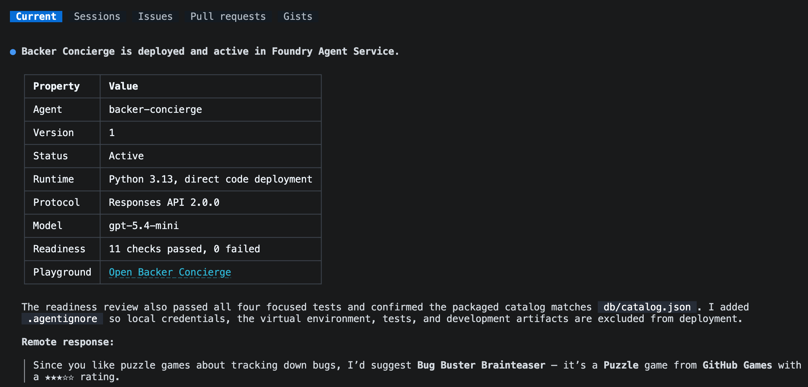

[モジュール 1][previous-lesson]では、カタログを準備し、デプロイ済みのモデルをテストしました。[コンシェルジュを作るオプションシリーズ][overview]の2番目のモジュールでは、その基盤をホスト型エージェントに発展させます。

このモジュールでは、次のことを行います。

- デプロイ可能な専用カタログコピーを含むエージェントのひな形を作成します。
- グラウンディングと会話の継続性をローカルでテストします。
- エージェントをデプロイし、リモートで呼び出します。

## シナリオ

Tailspin Toys が必要としているのは、モデルからの1回限りの回答だけではありません。支援者は、コンシェルジュが直前に勧めたゲームを覚えていて、それらについて追加の質問に答えることを期待しています。また、コンシェルジュを開発者のマシンからホスト型サービスに移しても、回答の信頼性を維持する必要があります。

## プロジェクトを続ける

このモジュールは、モジュール 1 で動作を確認したモデルを引き継ぎます。別の Azure リソース一式を作成せず、同じプロジェクトとデプロイを使います。

1. Codespace に戻り、`foundry-agent-cli` ブランチの Tailspin Toys リポジトリと、モジュール 1 の GitHub Copilot CLI（コマンドライン インターフェイス）セッションを開きます。
2. `db/catalog.json` が使えること、モデルテストで使った Foundry プロジェクト、選択したモデルデプロイ、Azure サインインが引き続き利用できることを確認します。セットアップが未完了の場合は、先に[プロジェクトとモデルを準備する][previous-lesson]を完了します。

> [!IMPORTANT]
> ホスト型エージェントはパブリックプレビューであり、課金対象の Azure リソースを作成します。このモジュールで終了する場合も、[クリーンアップの手順][cleanup]に従ってください。

## Backer Concierge エージェントのひな形を作成する

Microsoft Foundry Skill に、既存の Tailspin Toys リポジトリ内でホスト型エージェントのひな形を作成するよう依頼します。実行前にパッケージと構成を確認します。

1. Copilot CLI に次のプロンプトを入力します。

    ```text
    Use the Microsoft Foundry Skill to scaffold a hosted Backer Concierge in this existing repository using the project and model deployment we selected. Start from the Python 3.13 Basic hosted-agent sample, use Microsoft Agent Framework with the Responses API and code deployment, and keep the agent in agent/backer-concierge. Keep one azure.yaml at the repository root with a service using host: azure.ai.agent.

    Ground every answer in db/catalog.json. Never invent games, publishers, ratings, funding totals, backer counts, pledge tiers, prices, player counts, play times, or release dates. Ask one short clarifying question when a request is vague and preserve conversation context. Ensure the catalog is copied into the deployable service during preparation so the deployed agent never depends on a file outside its service directory. Add focused tests for catalog loading and grounding behavior.

    Scaffold and test locally, but do not deploy the hosted agent yet. Stop and ask me to authenticate if needed.
    ```

2. セッションを確認し、Foundry プロジェクト、モデルデプロイ、エージェント名、環境について質問されたら回答します。
3. Copilot の作業が終わったら、変更を確認します。

    ```text
    /diff
    ```

    次の点を確認します。

    - `azure.yaml` に `host: azure.ai.agent` のサービスが含まれている。
    - サービスが `agent/backer-concierge` を参照している。
    - デプロイするサービスパッケージに、自動生成されたカタログコピーが含まれている。
    - 手作業で編集するカタログを2つ維持するのではなく、1つのスクリプトまたはビルド手順で `db/catalog.json` からコピーを更新している。
    - エージェントが選択したモデルデプロイと Responses API を使っている。
    - カタログにない事実を明示的に使わないよう指示している。
    - 資格情報、アクセストークン、`.env` ファイル、`.azure` 環境ファイルがコミット用にステージされていない。

    ひな形を作成した後のチェックポイントとして、次の構成を確認します。

    ```text
    tailspin-toys/
    ├── azure.yaml
    ├── agent/
    │   └── backer-concierge/
    │       ├── catalog.json
    │       └── requirements.txt
    ├── db/
    │   └── catalog.json
    └── src/
    ```

> [!IMPORTANT]
> `azd deploy` はホスト型エージェントのサービスディレクトリをパッケージ化します。`agent/backer-concierge` からリポジトリルートの `db/catalog.json` を実行時に参照すると、ローカルでは動作してもデプロイ後に失敗する可能性があります。デプロイ前に `agent/backer-concierge/` 内で生成済みコピーを利用できるようにします。

4. サービスを起動する前に、対象を絞ったテストを実行し、生成された構成を検査するよう Copilot に依頼します。

    ```text
    Run the focused Backer Concierge tests. Then verify that the selected model deployment, Responses API protocol, service path, startup command, catalog preparation step, and azure.ai.agent host configuration are consistent. Fix only problems in this hosted-agent project and rerun the failed checks.
    ```

    対象を絞ったテストが成功するまでは続行しないでください。

    

## エージェントをローカルでテストする

ローカルの Responses API（アプリケーション プログラミング インターフェイス）を通じて、エージェントのグラウンディングと会話の動作を確認します。ローカルエージェントは実行中にターミナルを占有するため、Copilot CLI は現在のターミナルで開いたままにし、2つ目のターミナルからエージェントを起動します。

1. <kbd>Ctrl</kbd>+<kbd>\`</kbd> を押して、別のターミナルを開きます。
2. Tailspin Toys リポジトリのルートから次を実行します。

    ```bash
    azd ai agent run
    ```

    初回実行では Python 環境を作成し、依存関係をインストールして、ホスト型エージェントを起動します。このターミナルは開いたままにします。

3. 最初のターミナルで Copilot CLI に戻り、次を入力します。

    ```text
    Test the running Backer Concierge through its Responses API. Run each acceptance prompt below, preserve the response ID for the two-turn conversation test, and compare every response with the expected behavior. Show a concise pass or fail table and the evidence for any failure. Do not change code yet.

    1. "I love puzzle games about tracking down bugs. What should I back?" Expected: only real catalog titles with correct details.
    2. "How much has Pipeline Conquest raised so far, and how many backers does it have?" Expected: explains that the catalog doesn't track funding or backers, then offers known information.
    3. "I need something for four players, about an hour long." Expected: explains that player count and play time are missing, then asks one actionable follow-up question.
    4. "Do you have Wingspan? If not, what's the closest thing you've got?" Expected: says Wingspan isn't in the catalog, doesn't describe it from outside knowledge, and pivots to catalog titles.
    5. "Recommend me something good." Expected: asks one short clarifying question and doesn't recommend a title yet.
    6. "What are your three highest rated games?" Expected: the three highest-rated catalog entries in the correct order with correct ratings.
    7. In one conversation, send "Show me two highly rated strategy games." followed by "Which of those has the higher rating?" Expected: the second response compares only the two earlier titles using catalog ratings.
    ```

    

4. 結果を確認します。接続できない場合は、2つ目のターミナルでサービスが実行中か確認します。テストが失敗した場合は、ローカルの不具合だけを修正し、対象を絞ったテストを実行して、`azd ai agent run` を再起動するタイミングを知らせるよう Copilot に依頼します。変更のたびにサービスを再起動し、失敗した受け入れテストを再実行します。

## ホスト型エージェントをデプロイする

ローカルの受け入れテストが成功したら、エージェントを Microsoft Foundry にデプロイします。同じスキル主導のワークフローでデプロイ準備を確認し、リモートエンドポイントをテストします。

1. すべての受け入れテストが成功した後、<kbd>Ctrl</kbd>+<kbd>C</kbd> でローカルサービスを停止します。
2. Copilot CLI に戻り、次のプロンプトを入力します。デプロイを承認する前に、提案されたリソースと推定コストを確認します。

    ```text
    Continue with the Microsoft Foundry Skill workflow. Review the hosted agent for deployment readiness, then deploy it to Microsoft Foundry, show the deployment status and playground link, and invoke it remotely with: "I love puzzle games about tracking down bugs. What should I back?"
    ```

3. 評価スイートのソースを選ぶよう求められた場合は、**No, set it up later** を選択します。

    

4. デプロイ状況とリモートの応答を確認します。エージェントが実行中で、カタログに実在するゲームだけを勧めることを確認します。デプロイや呼び出しが失敗した場合は、原因を診断してリモートテストを繰り返すよう Copilot に依頼します。

表示されたプレイグラウンドのリンクから、Microsoft Foundry ポータルでデプロイ済みエージェントを操作できます。

スキル主導のワークフローでは、`azd deploy` を使ってサービスソースをパッケージ化し、依存関係を解決してリモートでビルドし、Microsoft Foundry に公開します。デプロイ済みのエンドポイントは Foundry の呼び出しワークフローでテストします。

## まとめと次のステップ

デプロイ可能なカタログコピーを含むエージェントのひな形を作成し、グラウンディングと会話の継続性をテストして、Microsoft Foundry からのリモート応答を検証しました。正常に動作するホスト型 Backer Concierge が完成しました。

次は、同じリポジトリ、ブランチ、Copilot CLI セッション、デプロイ済みエージェントを使って、[コンシェルジュを Web サイトに接続します][next-lesson]。ホスト型エージェントの探索だけで十分な場合は、ここで終了して [Azure リソースをクリーンアップしてください][cleanup]。

[overview]: ../
[previous-lesson]: ../1-project-and-model/
[next-lesson]: ../3-connect-to-site/
[cleanup]: ../#リソースをクリーンアップする
